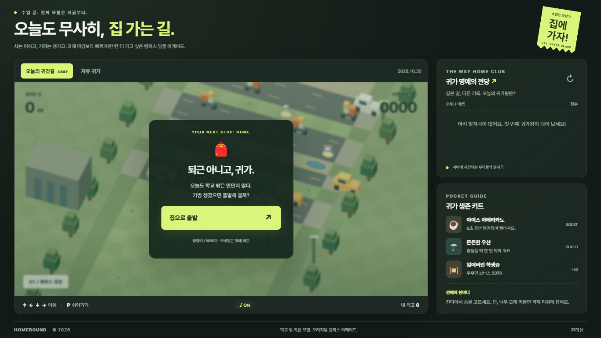
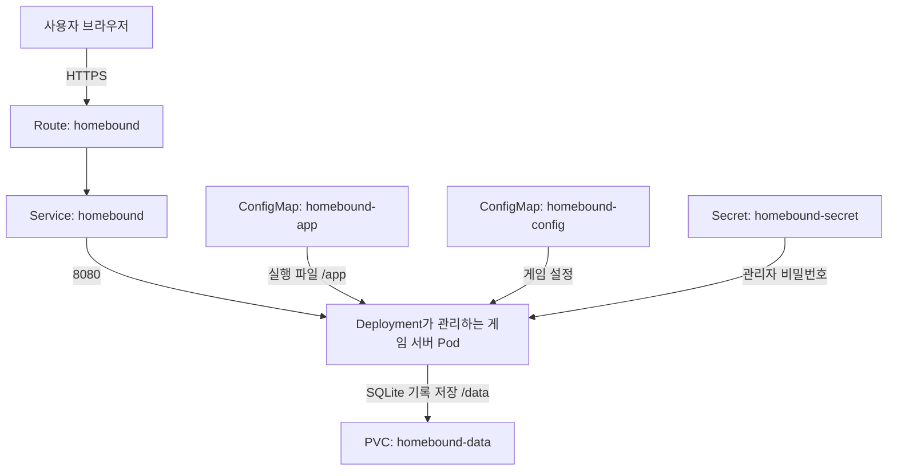
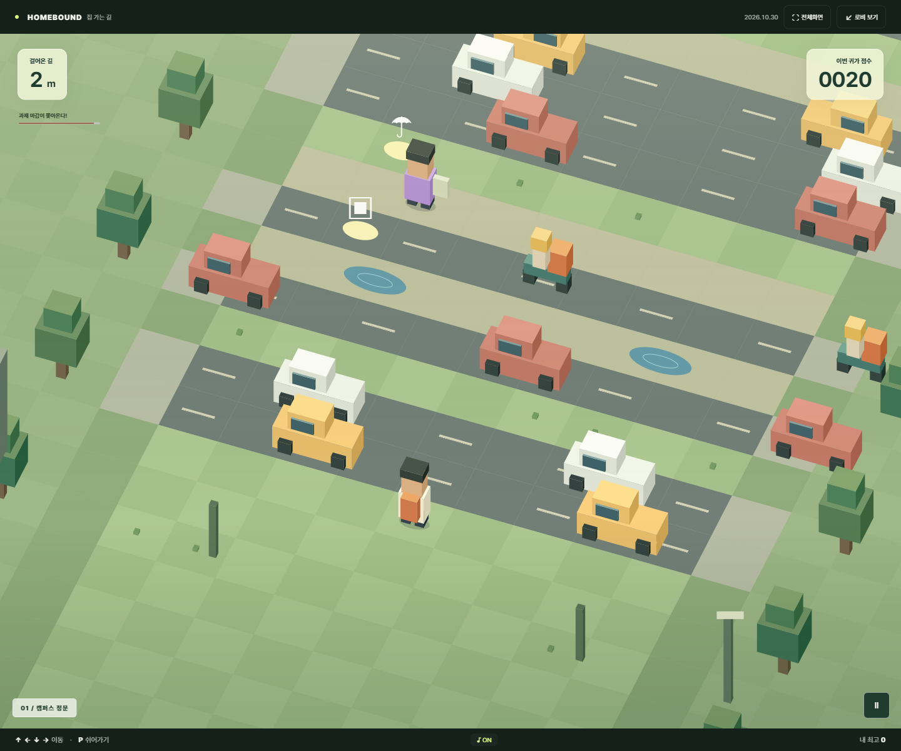
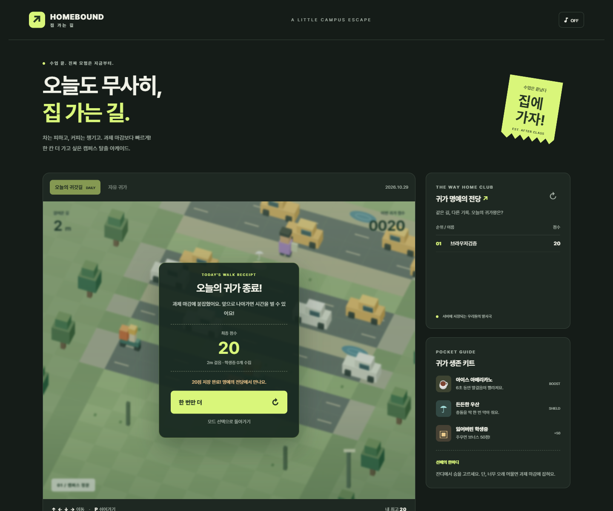

# 집 가는 길

**지능형 IoT 플랫폼 컨테이너 실습 과제 · 202355513**

수업을 마친 대학생이 자동차와 장애물을 피해 집으로 가는 웹 게임입니다.

**[게임 접속](https://homebound-skygang-dev.apps.rm1.0a51.p1.openshiftapps.com/)**

## 1. 어떤 서비스인가요?

길건너 친구들처럼 조작은 간단하지만 자꾸 다시 하게 되는 게임을 만들어 보고 싶었습니다. 배경은 캠퍼스와 대학가로 정했고, 설문조사에 붙잡히거나 과제 마감에 쫓기는 상황을 넣었습니다.

게임만 실행하는 데서 끝내지 않고 다른 사람의 기록과 비교할 수 있도록 서버 랭킹도 만들었습니다. 이 과정에서 게임 설정은 ConfigMap, 관리자 비밀번호는 Secret, 저장한 기록은 PVC로 나누어 구성했습니다.

- 방향키나 WASD로 한 칸씩 움직입니다. 휴대폰에서는 방향 버튼과 스와이프를 사용할 수 있습니다.
- 자동차, 배달 오토바이, 물웅덩이를 피해야 합니다. 설문조사 보행자와 취객에게 걸리면 남은 시간이 줄어듭니다.
- 커피는 이동 속도를 높이고, 우산은 충돌을 한 번 막아 줍니다. 학생증은 50점을 추가합니다.
- 앞으로 나아가지 않으면 기본 18초 뒤 과제 마감에 잡혀 게임이 끝납니다.
- `오늘의 귀갓길`은 한국 시간 날짜를 기준으로 같은 맵을 제공합니다. `자유 귀가`는 시작할 때마다 맵이 달라집니다.
- 닉네임별 최고 점수를 저장합니다. 일일 모드는 당일 기록, 자유 모드는 전체 기록을 비교합니다.

점수는 **이동 거리 × 10 + 학생증 수 × 50**으로 계산합니다.

시작 버튼을 누르면 게임이 화면을 채웁니다. `전체화면` 버튼은 주소창까지 숨기고, `로비 보기`나 Escape는 진행 중인 게임을 일시정지한 채 로비로 돌아갑니다. P 키로도 쉬어갈 수 있습니다.

효과음과 배경음은 기본으로 켜져 있습니다. 브라우저의 자동재생 제한 때문에 처음 접속했을 때는 소리가 나지 않고, 시작 버튼을 누른 뒤 재생됩니다. 게임 아래 `♪ ON/OFF` 버튼으로 함께 끌 수 있습니다. 배경음은 Web Audio로 만든 짧은 반복 멜로디이며, 일시정지하거나 게임이 끝나면 멈춥니다. 캐릭터와 배경도 Canvas로 그렸으며 원작의 이미지나 음악 파일을 사용하지 않았습니다.



## 2. 아키텍처



게임 화면은 브라우저에서 그리고, Python 서버는 게임 시작 정보와 랭킹을 처리합니다. 사용자는 Route 주소로 접속하고, Service가 `app=homebound` 라벨을 가진 Pod의 `http` 포트로 요청을 전달합니다.

| 사용한 Object | 역할 |
|---|---|
| Deployment | 게임 서버 Pod 1개를 실행합니다. Pod를 삭제하면 다시 생성합니다. |
| Service | Pod 주소가 바뀌어도 같은 서비스 이름과 포트로 접근하게 합니다. |
| Route | 외부 HTTPS 주소를 제공합니다. HTTP 요청은 HTTPS로 보냅니다. |
| ConfigMap `homebound-app` | Python, HTML, CSS, JavaScript를 저장해 `/app`에 읽기 전용으로 연결합니다. |
| ConfigMap `homebound-config` | 게임 제목, 마감 시간, 교통 속도, 포트를 환경변수로 전달합니다. |
| Secret | 관리실에서 기록을 초기화할 때 확인하는 비밀번호를 전달합니다. |
| PVC | `/data/homebound.db`에 랭킹과 게임 세션을 저장합니다. Pod가 바뀌어도 기록이 남습니다. |

상태 확인에는 세 가지 Probe를 사용했습니다. Probe는 별도의 Object가 아니라 Deployment 안의 컨테이너 설정입니다.

| Probe | 확인 주소 | 용도 |
|---|---|---|
| Startup | `/health/ready` | 시작할 때 DB 준비가 끝날 때까지 기다립니다. 2초 간격으로 최대 30번 확인합니다. |
| Readiness | `/health/ready` | DB 테이블을 조회할 수 있을 때만 요청을 받습니다. |
| Liveness | `/health/live` | DB 준비 상태와 별도로 서버의 HTTP 응답을 확인합니다. |

CPU는 요청 50m·상한 500m, 메모리는 요청 64Mi·상한 256Mi로 설정했습니다. SQLite와 ReadWriteOnce 볼륨을 사용하므로 Pod는 1개만 실행하고, 업데이트 전략은 `Recreate`로 두었습니다. 업데이트 중에는 잠시 접속이 끊길 수 있습니다.

다른 프로젝트에서도 배포할 수 있도록 YAML에 namespace, Route host, uid, status 같은 환경별 값을 넣지 않았습니다. 실행 UID는 OpenShift가 정하며, 루트 파일시스템은 읽기 전용입니다. 파일 쓰기는 `/data`와 `/tmp`에서만 합니다.

## 3. 사용 이미지

```text
registry.access.redhat.com/ubi9/python-312:latest
```

Python 3.12가 포함된 Red Hat UBI9 공개 이미지입니다. OpenShift의 비루트 환경에서 실행할 수 있고, Python 기본 라이브러리만으로 웹 서버와 SQLite 저장 기능을 구성할 수 있어 선택했습니다. 사용하는 포트는 **8080**입니다.

별도 이미지 빌드나 배포 중 패키지 설치는 필요하지 않습니다. 실제 배포에 사용된 이미지 digest는 [검증 기록](evidence/deployment-verification.json)에 남겼습니다. `latest` 태그의 이미지는 이후 변경될 수 있습니다.

## 4. 배포 방법

OpenShift CLI에 로그인하고 프로젝트를 선택한 뒤, `students/202355513` 폴더에서 실행합니다.

```sh
oc project <본인-project>
oc apply -f k8s/
oc rollout status deployment/homebound --timeout=120s
oc get deployment,pod,replicaset,service,route,pvc -l app=homebound
oc get pvc homebound-data
oc get route homebound -o jsonpath='{.spec.host}'
```

마지막에 나온 주소 앞에 `https://`를 붙여 접속합니다. 게임 제목, `집으로 출발` 버튼, 랭킹이 보이면 정상입니다. 시작 후 방향키로 이동할 수 있는지도 확인합니다. `/health/live`와 `/health/ready`에서는 각각 `alive`, `ready`라는 JSON 응답이 나옵니다.

`k8s/`에는 실행 코드까지 포함한 7개 리소스가 들어 있으므로 이 폴더만으로 배포할 수 있습니다. `.yaml` 파일은 YAML에서 읽을 수 있는 JSON 표기로 저장했습니다. 소스 코드의 따옴표와 줄바꿈을 그대로 넣기 위한 방식이며 `oc apply`에서 바로 사용할 수 있습니다.

### 설정과 관리자 기능

`k8s/configmap.yaml`의 `DEADLINE_SECONDS`는 마감 시간(기본 18초), `TRAFFIC_SPEED`는 교통 속도(기본 1배), `GAME_TITLE`은 브라우저 제목입니다. 값을 바꾸고 적용한 뒤 Pod를 재시작하면 새 게임부터 반영됩니다.

```sh
oc apply -f k8s/configmap.yaml
oc rollout restart deployment/homebound
```

로비 하단 `관리실`에서 비밀번호를 입력하고 초기화 확인란을 선택하면 랭킹을 지울 수 있습니다. 제출용 데모 비밀번호는 **`homebound-demo-2026!`**입니다. 공개된 실습용 값이므로 실제 운영에서는 Secret의 값을 바꾸고 Deployment를 재시작해야 합니다. 비밀번호 검증은 서버에서 처리합니다.

### 소스를 수정할 때

`app/` 안의 소스를 고친 뒤 다음 명령으로 배포 파일에 반영합니다. 생성기는 설정과 데모 Secret도 기본값으로 다시 만들므로, 설정 기본값을 유지해서 바꾸려면 생성 스크립트도 수정해야 합니다.

```sh
python scripts/build_manifests.py
python scripts/check_manifests.py
oc apply -f k8s/
oc rollout restart deployment/homebound
```

로컬에서는 `python app/server.py`로 실행한 뒤 `http://localhost:8080`으로 접속합니다. 로컬 저장 파일은 `.local-data/`에 생성됩니다.

## 5. 배포 결과

Developer Sandbox에 배포한 뒤 Pod의 `Running / 1/1`, PVC의 `Bound`, Route의 HTTPS 접속을 확인했습니다. [최근 리소스 조회 출력](evidence/current-resources.txt), [브라우저 확인 결과](evidence/live-browser.json)를 함께 저장했습니다.

배포 상태는 다음 명령으로 확인할 수 있습니다.

```sh
oc get deployment,pod,replicaset,service,route,pvc -l app=homebound
```

아래는 실제 OpenShift 주소에 접속해 플레이한 화면입니다.



아래는 로컬 브라우저 테스트에서 게임을 마치고 점수를 저장한 화면입니다.



### YAML만으로 다시 배포

2026년 10월 29일, 다음 순서로 전체 리소스를 지운 뒤 다시 배포했습니다. 새 PVC에 DB가 자동으로 만들어지고 게임과 기록 저장이 동작하는 것을 확인했습니다.

```sh
oc delete -f k8s/
oc apply -f k8s/
oc rollout status deployment/homebound --timeout=120s
```

이 명령은 PVC도 지우므로 기존 기록을 보존하는 절차는 아닙니다. 실행 과정은 [재배포 로그](evidence/openshift-status.txt)에 남겼습니다.

### Pod를 바꿔도 기록이 남는지 확인

자유 귀가 랭킹에 `배포검증`이라는 이름으로 20점을 저장한 뒤 Pod만 삭제했습니다.

```sh
oc delete pod -l app=homebound
oc rollout status deployment/homebound --timeout=120s
```

새 Pod의 UID가 이전과 달라졌고, `/api/leaderboard?mode=endless`의 기록은 동일했습니다. 이때 PVC는 삭제하지 않았습니다. 비교한 응답과 Pod UID는 [영속성 검증 기록](evidence/deployment-verification.json)에 있습니다. 브라우저에 표시되는 ‘내 최고’는 localStorage를 쓰므로 이 확인에는 사용하지 않았습니다.

키보드·모바일 조작, 점수 저장, 관리자 인증, 화면 크기 변경, 전체화면, 사운드는 자동 테스트로도 확인합니다.

```sh
python -m unittest discover -s tests -p test_server.py -v
npm ci
npm test
npx playwright test
```

브라우저 테스트에는 설치된 Chrome을 사용합니다. 테스트 도구는 개발용이며 배포 컨테이너에는 필요하지 않습니다.

## 6. 구현하면서 고려한 점

**배포 재현성**을 위해 실행 파일 전체를 ConfigMap에 담았습니다. 소스는 `app/`에서 관리하고 생성 스크립트로 배포 파일에 반영합니다. 제출받은 사람은 이미지를 직접 빌드하지 않고 `k8s/`만 적용하면 게임을 실행할 수 있습니다.

**플레이 화면**은 데스크톱과 노트북의 창 높이에 맞춰 배치했습니다. 시작하면 게임이 화면을 채우고, 로비로 돌아오면 진행 상태를 유지한 채 일시정지합니다. 배경음도 게임의 시작·일시정지·종료에 맞춰 재생됩니다.

**기록 보존**은 실제 Pod 교체로 확인했습니다. PVC를 유지한 상태에서 Pod를 삭제하고, 새 Pod가 응답한 랭킹을 이전 기록과 비교했습니다. 게임 서버의 수명과 저장 데이터의 수명을 분리한 구성입니다.

## 7. AI와 참고자료

기획 정리, 게임과 서버 코드 작성, YAML 구성, 테스트와 동작 검증에 ChatGPT와 Codex를 사용했습니다. 생성된 코드는 로컬에서 실행하고 본인 Sandbox 계정에 배포해 확인했습니다. 배포 및 재현성 검증 결과는 `evidence/`에 기록했습니다.

- 수업 과제 안내: 부산대학교 「제5강 과제안내 — 나만의 컨테이너 만들기」
- [Kubernetes ConfigMap](https://kubernetes.io/docs/concepts/configuration/configmap/)
- [Kubernetes Secret](https://kubernetes.io/docs/concepts/configuration/secret/)
- [Kubernetes Persistent Volumes](https://kubernetes.io/docs/concepts/storage/persistent-volumes/)
- [Kubernetes Liveness, Readiness, Startup Probes](https://kubernetes.io/docs/concepts/workloads/pods/probes/)
