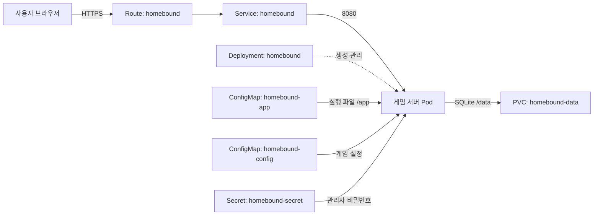
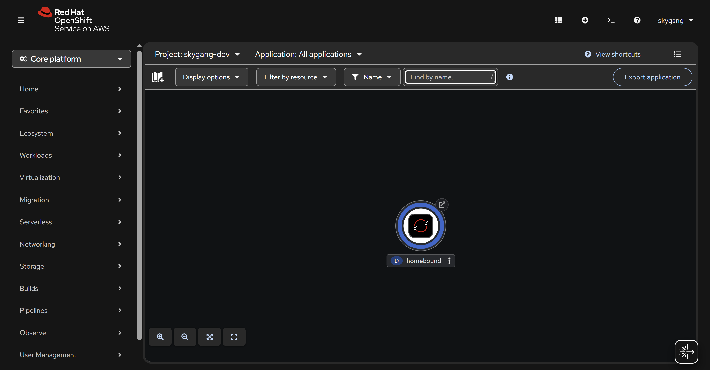

# 집 가는 길 · HOMEBOUND

자동차와 장애물을 피해 대학가를 건너는 웹 게임

지능형 IoT 플랫폼 컨테이너 1차 과제 · **202355513 강준이**

**[게임 실행하기](https://homebound-skygang-dev.apps.rm1.0a51.p1.openshiftapps.com/)** · [배포 YAML](k8s/) · [배포 확인 기록](evidence/current-resources.txt)


## 1. 서비스 소개

길건너 친구들의 간단한 조작과 짧게 반복하는 플레이를 대학생의 귀갓길에 담아 보고 싶었습니다. 자동차와 배달 오토바이를 피하는 길 위에 설문조사, 취객, 과제 마감을 더했습니다. 익숙한 일상을 게임으로 옮기되, 다른 사람과 기록을 겨룰 수 있도록 서버 랭킹도 만들었습니다.

**오늘의 귀갓길**에서는 한국 시간 날짜를 기준으로 모두가 같은 맵에 도전합니다. **자유 귀가**에서는 시작할 때마다 새로운 맵을 만납니다. 닉네임별 최고 점수를 저장하며, 오늘의 귀갓길은 당일 기록, 자유 귀가는 전체 기록으로 순위를 매깁니다.

### 플레이 방법

방향키 또는 WASD로 한 칸씩 움직입니다. 휴대폰에서는 화면의 방향 버튼이나 스와이프를 사용합니다. 자동차·오토바이·물웅덩이를 피하고, 설문조사 보행자와 취객에게 빼앗기는 시간도 조심해야 합니다. 앞으로 나아가지 않으면 기본 18초 뒤 과제 마감에 잡혀 게임이 끝납니다.

커피는 이동 속도를 높이고, 우산은 충돌을 한 번 막아 줍니다. 학생증을 모으면 추가 점수를 얻습니다.

> **점수 = 이동 거리 × 10 + 학생증 수 × 50**

시작 버튼을 누르면 게임이 화면을 채웁니다. `전체화면` 버튼으로 주소창까지 숨길 수 있고, `로비 보기`나 Escape로 돌아오면 진행 상태를 유지한 채 일시정지합니다. P 키로도 멈추고 이어갈 수 있습니다.

배경음과 효과음은 기본으로 켜져 있으며, 시작 버튼을 누른 뒤 재생됩니다. `♪ ON/OFF`로 함께 끌 수 있습니다. 화면은 Canvas로, 소리는 Web Audio로 만들었으며 원작의 이미지나 음악 파일은 사용하지 않았습니다.

## 2. 서비스 구성

브라우저는 게임 화면과 조작을 담당하고, Python 서버는 게임 시작 정보와 랭킹을 처리합니다. 기록은 SQLite에 저장합니다.



### Object를 나눈 이유

게임 실행, 설정, 관리자 인증, 기록 저장을 각각 분리했습니다. 각 Object는 다음과 같이 실제 서비스 기능에 연결됩니다.

| Object · 이름 | 서비스에서 맡은 역할 | 배포 파일 |
|---|---|---|
| Deployment · `homebound` | 서버 Pod 1개를 실행하고 관리 | [deployment.yaml](k8s/deployment.yaml) |
| Service · `homebound` | `app=homebound`인 Pod의 `http` 포트로 요청 전달 | [service.yaml](k8s/service.yaml) |
| Route · `homebound` | 외부 HTTPS 접속 제공, HTTP는 HTTPS로 전환 | [route.yaml](k8s/route.yaml) |
| ConfigMap · `homebound-app` | 실행 코드 전체를 `/app`에 읽기 전용으로 제공 | [app-configmap.yaml](k8s/app-configmap.yaml) |
| ConfigMap · `homebound-config` | 게임 제목·마감 시간·교통 속도·포트를 환경변수로 전달 | [configmap.yaml](k8s/configmap.yaml) |
| Secret · `homebound-secret` | 랭킹 초기화에 필요한 관리자 비밀번호 전달 | [secret.yaml](k8s/secret.yaml) |
| PVC · `homebound-data` | `/data/homebound.db`에 랭킹과 게임 세션을 저장해 Pod 교체 후에도 보존 | [pvc.yaml](k8s/pvc.yaml) |

**서버의 준비 상태와 실행 상태도 구분했습니다.** Startup Probe는 `/health/ready`를 2초 간격으로 최대 30번 확인하며 DB 준비를 기다립니다. 이후 Readiness Probe가 같은 주소로 요청 수신 가능 여부를 확인하고, Liveness Probe는 `/health/live`로 서버의 응답 여부를 확인합니다. 세 Probe는 별도 Object가 아니라 Deployment 안의 컨테이너 설정입니다.

**Sandbox 환경에 맞춰 자원을 지정했습니다.** CPU 요청·상한은 `50m / 500m`, 메모리는 `64Mi / 256Mi`입니다. PVC는 `500Mi`, `ReadWriteOnce`로 요청하며, SQLite를 사용하는 단일 Pod 구성에 맞춰 업데이트 전략을 `Recreate`로 두었습니다.

Deployment의 Pod 라벨과 Service selector는 `app=homebound`로 일치시켰습니다. Service의 `targetPort`와 Route의 대상 포트는 모두 컨테이너의 `http` 포트에 연결됩니다. YAML에는 고정 namespace, Route host, uid, status 등 환경별·자동 생성 값을 넣지 않았습니다. OpenShift가 부여하는 비루트 UID로 실행하고, 쓰기 공간은 `/data`와 `/tmp`로 한정했습니다.

## 3. 사용 이미지

```text
registry.access.redhat.com/ubi9/python-312:latest
```

Red Hat UBI9 기반의 Python 3.12 공개 이미지입니다. OpenShift의 비루트 실행 환경에 맞고, Python 기본 라이브러리만으로 HTTP 서버와 SQLite를 함께 사용할 수 있어 선택했습니다. **서버와 Service의 포트는 8080**입니다.

실행 코드는 ConfigMap으로 전달하므로 별도 이미지 빌드나 배포 중 패키지 설치가 필요하지 않습니다. `latest` 태그는 변경될 수 있어, 검증 당시의 실제 이미지 digest도 [배포 검증 기록](evidence/deployment-verification.json)에 남겼습니다.

## 4. 배포하고 실행하기

**`k8s/` 폴더만으로 배포할 수 있습니다.** 실행 코드를 포함한 7개 YAML 파일이 들어 있습니다. 파일 내용은 YAML과 호환되는 JSON 표기이며 `oc apply`에서 그대로 읽습니다.

OpenShift CLI에 로그인한 뒤 저장소 루트에서 실행합니다. `<본인-project>`에는 자신의 Sandbox 프로젝트 이름을 넣습니다.

```sh
cd students/202355513
oc project <본인-project>
oc apply -f k8s/
oc rollout status deployment/homebound --timeout=120s
oc get deployment,pod,service,route,pvc -l app=homebound
oc get route homebound -o jsonpath='{.spec.host}'
```

Pod가 **`Running`, `1/1`**, PVC가 **`Bound`**인지 확인합니다. 마지막 명령에 나온 호스트 앞에 `https://`를 붙여 접속하면 게임 제목, `집으로 출발` 버튼, 랭킹이 보입니다. 시작 후 이동하고, 게임이 끝나면 닉네임을 입력해 기록을 저장할 수 있습니다.

상태 확인 주소는 `/health/live`와 `/health/ready`입니다. 정상 응답은 각각 `{"status":"alive"}`, `{"status":"ready"}`입니다.

### 설정과 관리실

[configmap.yaml](k8s/configmap.yaml)의 `DEADLINE_SECONDS`로 마감 시간(기본 18초), `TRAFFIC_SPEED`로 교통 속도(기본 1배), `GAME_TITLE`로 브라우저 제목을 바꿀 수 있습니다. 수정 후 다음 명령으로 적용합니다.

```sh
oc apply -f k8s/configmap.yaml
oc rollout restart deployment/homebound
```

로비 하단 **관리실**에서는 비밀번호와 초기화 확인란을 통해 랭킹을 지울 수 있습니다. 비밀번호는 Secret에서 서버로 전달하며 서버에서 검증합니다. 제출용 데모 값은 `homebound-demo-2026!`입니다. 실제 운영 시에는 [secret.yaml](k8s/secret.yaml)의 값을 변경해 적용하고 Pod를 재시작합니다.

## 5. 배포 결과와 검증

본인 Developer Sandbox의 `skygang-dev` 프로젝트에 배포했습니다. 아래 화면은 **실제 OpenShift Route에 접속해 플레이한 결과**입니다.


아래는 OpenShift 웹 콘솔에서 확인한 서비스의 Topology 화면입니다.



| 확인 항목 | 확인 결과 | 증빙 |
|---|---|---|
| 리소스 상태 | Deployment `1/1`, Pod `Running / 1/1`, PVC `Bound` | [리소스 조회 원문](evidence/current-resources.txt) |
| Route 접속과 게임 조작 | HTTPS 200 응답, 이동·일시정지·화면 전환 확인 | [브라우저 검증 결과](evidence/live-browser.json) |
| YAML 재배포 | 전체 리소스 삭제 후 `k8s/`만으로 재생성·실행 | [재배포 로그](evidence/openshift-status.txt) |
| 기록 보존 | Pod UID가 바뀐 뒤에도 `배포검증`의 20점 기록 유지 | [교체 전후 랭킹 응답](evidence/deployment-verification.json) |

리소스 상태는 2026년 10월 30일 00:50 KST에 저장한 조회 결과입니다. PVC는 `500Mi`를 요청했고, Sandbox에서 실제 할당된 용량은 `1Gi`입니다.

<details>
<summary>배포 상태 출력 보기</summary>

`oc get deployment,pod,replicaset,service,route,pvc -l app=homebound`의 출력 중 Deployment와 Pod 부분입니다. 전체 출력은 위 증빙 파일에 있습니다.

```text
NAME                        READY   UP-TO-DATE   AVAILABLE   AGE
deployment.apps/homebound   1/1     1            1           60m

NAME                             READY   STATUS    RESTARTS   AGE
pod/homebound-6dc7f798b7-gl55n   1/1     Running   0          10m
```

</details>

### 재배포와 데이터 보존

2026년 10월 29일에는 전체 리소스를 삭제하고 `oc apply -f k8s/`로 다시 배포했습니다. 새 PVC에 DB가 자동으로 생성되고 게임과 기록 저장이 동작하는 것을 확인했습니다.

영속성은 별도로 확인했습니다. 자유 귀가 랭킹에 `배포검증`의 20점을 저장하고 **PVC는 유지한 채 Pod만 삭제**했습니다. 새 Pod의 UID는 달라졌지만 `/api/leaderboard?mode=endless`의 응답은 교체 전과 같았습니다. 브라우저의 ‘내 최고’ 기록이 아닌 서버에 저장된 랭킹을 비교했습니다.

<details>
<summary>검증에 사용한 명령 보기</summary>

전체 재배포는 PVC까지 삭제하므로 기존 기록도 함께 지웁니다.

```sh
oc delete -f k8s/
oc apply -f k8s/
oc rollout status deployment/homebound --timeout=120s
```

데이터 보존 확인에서는 Pod만 교체합니다.

```sh
oc delete pod -l app=homebound
oc rollout status deployment/homebound --timeout=120s
```

</details>

<details>
<summary>게임 종료·기록 저장 화면 보기</summary>

로컬 브라우저 테스트에서 게임을 마치고 기록을 저장한 화면입니다.


</details>

<details>
<summary>로컬 실행과 자동 테스트</summary>

`students/202355513`에서 `python app/server.py`를 실행하고 `http://localhost:8080`으로 접속합니다. 로컬 기록은 `.local-data/`에 저장됩니다.

서버 API와 기록 저장, 게임 로직, 키보드·모바일 조작, 화면 크기, 전체화면, 사운드를 테스트합니다.

```sh
python scripts/check_manifests.py
python -m unittest discover -s tests -p test_server.py -v
npm ci
npm test
npx playwright test
```

브라우저 테스트에는 설치된 Chrome을 사용합니다. 테스트 도구는 개발용이며 배포 컨테이너에는 필요하지 않습니다. `app/`을 수정할 때는 `python scripts/build_manifests.py`로 배포 파일에 반영합니다. 생성기는 설정과 데모 Secret도 기본값으로 다시 만듭니다.

</details>

## 6. AI 활용과 참고자료

Codex는 초기 기획 정리, 게임·서버 코드와 배포 YAML 작성, 테스트와 동작 검증에 활용했습니다. 완성된 결과는 로컬과 본인 Sandbox 환경에서 실행했으며, 배포와 데이터 보존 확인 결과는 `evidence/`에 남겼습니다.

과제 범위와 제출 형식은 부산대학교 「제5강 과제안내 — 나만의 컨테이너 만들기」를 기준으로 정리했습니다. 각 리소스의 역할은 Kubernetes 공식 문서를 참고했습니다.

- 설정과 인증 정보: [ConfigMap](https://kubernetes.io/docs/concepts/configuration/configmap/) · [Secret](https://kubernetes.io/docs/concepts/configuration/secret/)
- 저장 공간과 상태 확인: [Persistent Volumes](https://kubernetes.io/docs/concepts/storage/persistent-volumes/) · [Liveness, Readiness, Startup Probes](https://kubernetes.io/docs/concepts/workloads/pods/probes/)
