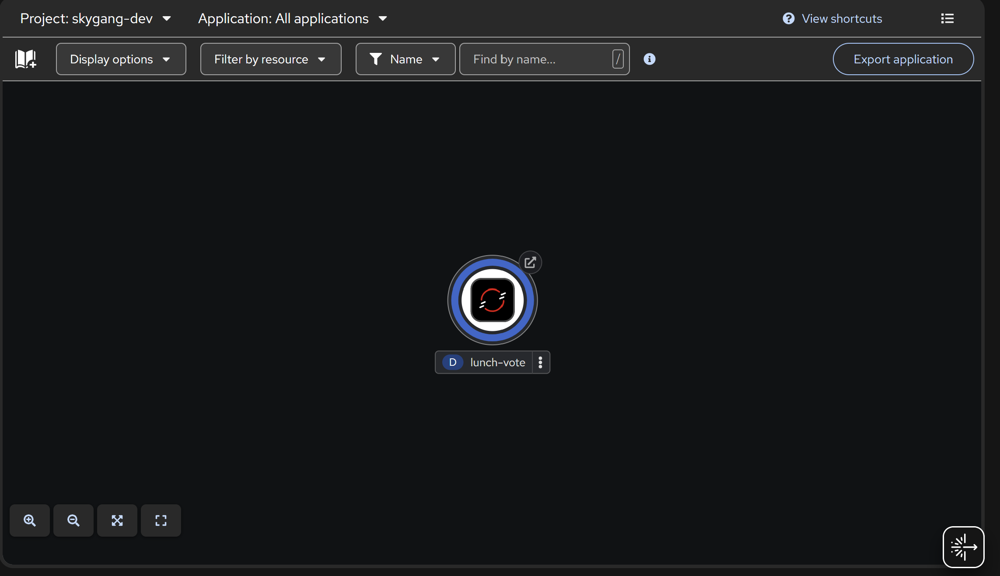
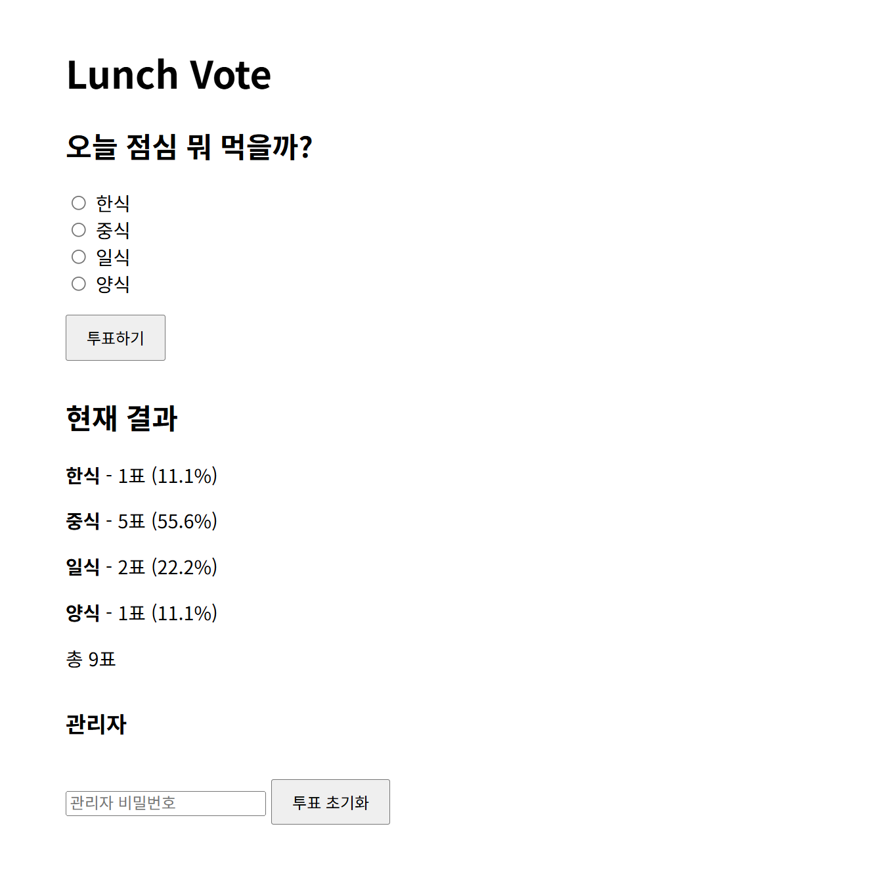
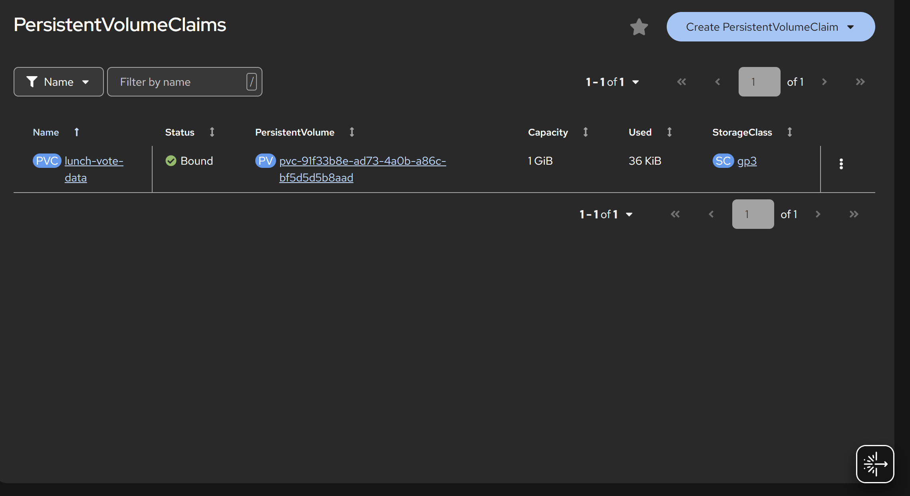

# Lunch Vote

간단한 점심 메뉴 투표 서비스입니다.  
사용자는 원하는 메뉴에 투표하고 현재 결과를 확인할 수 있으며, 투표 결과는 영구 저장되어 Pod가 재생성되어도 유지됩니다.

---

## 1. 컨테이너 소개

### 서비스 목적

OpenShift에서 웹 애플리케이션을 배포하면서 `Deployment`, `Service`, `Route`뿐만 아니라 `ConfigMap`, `Secret`, `PVC`, `Probe` 등 수업에서 학습한 Object를 함께 활용해 보기 위해 제작했습니다.

### 주요 기능

- 점심 메뉴 선택 및 투표
- 현재 투표 결과 및 비율 확인
- 관리자 비밀번호를 이용한 투표 결과 초기화
- PVC를 이용한 투표 데이터 영구 저장
- Pod 재생성 후에도 기존 투표 결과 유지

---

## 2. 아키텍처

```text
사용자
  ↓
Route
  ↓
Service
  ↓
Lunch Vote Pod
  ├─ ConfigMap
  │   ├─ 투표 질문
  │   ├─ 투표 선택지
  │   └─ Python 애플리케이션 코드
  │
  ├─ Secret
  │   └─ 관리자 비밀번호
  │
  └─ PVC
      └─ SQLite 투표 데이터
```

### 사용한 Object

| Object | 역할 |
|---|---|
| `Deployment` | Lunch Vote 애플리케이션 Pod 관리 |
| `Service` | Pod에 안정적인 내부 접근 제공 |
| `Route` | 외부 브라우저에서 서비스 접근 |
| `ConfigMap` | 투표 질문, 선택지 및 애플리케이션 코드 관리 |
| `Secret` | 관리자 비밀번호 관리 |
| `PersistentVolumeClaim` | SQLite 투표 데이터 영구 저장 |
| `Startup Probe` | 애플리케이션 시작 완료 여부 확인 |
| `Readiness Probe` | 요청을 받을 준비가 되었는지 확인 |
| `Liveness Probe` | 애플리케이션 정상 동작 여부 확인 |

Deployment에는 CPU와 Memory의 `requests`, `limits`도 설정하여 컨테이너의 리소스 사용량을 제한했습니다.

---

## 3. 사용 이미지

```text
registry.access.redhat.com/ubi9/python-312:latest
```

- Red Hat UBI9 기반 Python 3.12 이미지
- OpenShift의 비루트 실행 환경에 적합
- 별도의 이미지 빌드 없이 Python 애플리케이션 실행
- 애플리케이션 포트: `8080`

투표 데이터 저장에는 Python 기본 라이브러리의 SQLite를 사용했습니다.

---

## 4. 배포 방법

### 1. OpenShift 프로젝트 선택

```bash
oc project <project-name>
```

### 2. 전체 Object 배포

학번 폴더에서 다음 명령을 실행합니다.

```bash
oc apply -f k8s/
```

### 3. 배포 상태 확인

```bash
oc get pods
oc get pvc
oc get route
```

정상적으로 배포되면 다음 상태를 확인할 수 있습니다.

```text
Pod   : Running
PVC   : Bound
Route : 생성 완료
```

Route 주소는 다음 명령으로 확인할 수 있습니다.

```bash
oc get route lunch-vote
```

---

## 5. 배포 결과

### Pod 정상 실행

```text
NAME                          READY   STATUS    RESTARTS
lunch-vote-75559f7d76-mmzbn   1/1     Running   0
```

### PVC 정상 연결

```text
NAME              STATUS
lunch-vote-data   Bound
```

SQLite 데이터베이스는 PVC가 마운트된 `/data` 경로에 저장됩니다.

### 데이터 영속성 확인

1. Lunch Vote에서 여러 번 투표
2. 실행 중인 `lunch-vote` Pod 삭제
3. Deployment가 새로운 Pod 자동 생성
4. Route를 통해 다시 접속
5. 기존 투표 결과가 그대로 유지되는 것을 확인

이를 통해 Pod가 재생성되어도 PVC에 저장된 투표 데이터가 유지되는 것을 확인했습니다.

### YAML 재현성 확인

실제 채점 방식과 동일하게 전체 Object를 삭제한 뒤 다시 배포했습니다.

```bash
oc delete -f k8s/
oc apply -f k8s/
```

재배포 후에도 다음 상태를 정상적으로 확인했습니다.

```text
Pod   : Running
PVC   : Bound
Route : 정상 생성
```

### 서비스 접속

배포된 Lunch Vote 서비스는 아래 Route 주소에서 확인할 수 있습니다.

[Lunch Vote 실행 화면](https://lunch-vote-skygang-dev.apps.rm1.0a51.p1.openshiftapps.com/)

---

## 6. 실행 화면

### OpenShift Topology



### Lunch Vote 실행 화면



### PVC 상태



---

## 7. 어려웠던 점

처음에는 OpenShift 웹 콘솔을 이용해 Object를 하나씩 배포했습니다.

이후 과제의 재현성 조건을 확인하기 위해 Windows에 OpenShift CLI(`oc`)를 설치하고, YAML 파일만으로 전체 리소스를 삭제한 뒤 다시 배포했습니다.

또한 PVC를 연결한 뒤 Pod를 직접 삭제하여 새로운 Pod가 생성되더라도 SQLite의 기존 투표 결과가 유지되는지 확인했습니다.

---

## 8. AI 및 참고자료 활용 내역

### AI 활용

- ChatGPT
  - Kubernetes/OpenShift YAML 초안 작성
  - ConfigMap, Secret, PVC, Probe 구성 검토
  - 배포 과정 및 오류 확인

AI를 활용해 작성한 YAML은 Developer Sandbox에서 직접 배포하고 동작 여부를 확인했습니다.

### 참고자료

- 부산대학교 지능형 IoT 플랫폼 수업자료
- OpenShift / Kubernetes 핸즈온 워크샵 매뉴얼
- Red Hat OpenShift Developer Sandbox