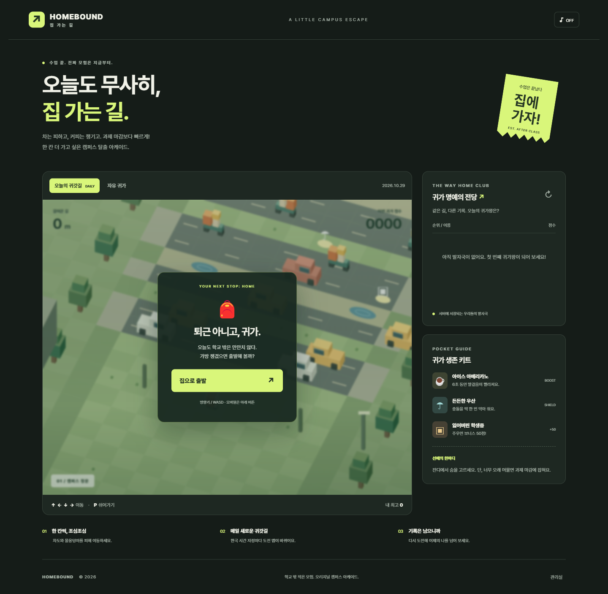
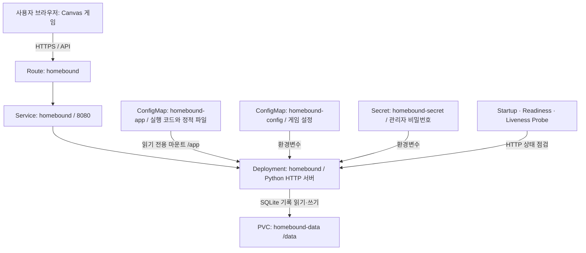
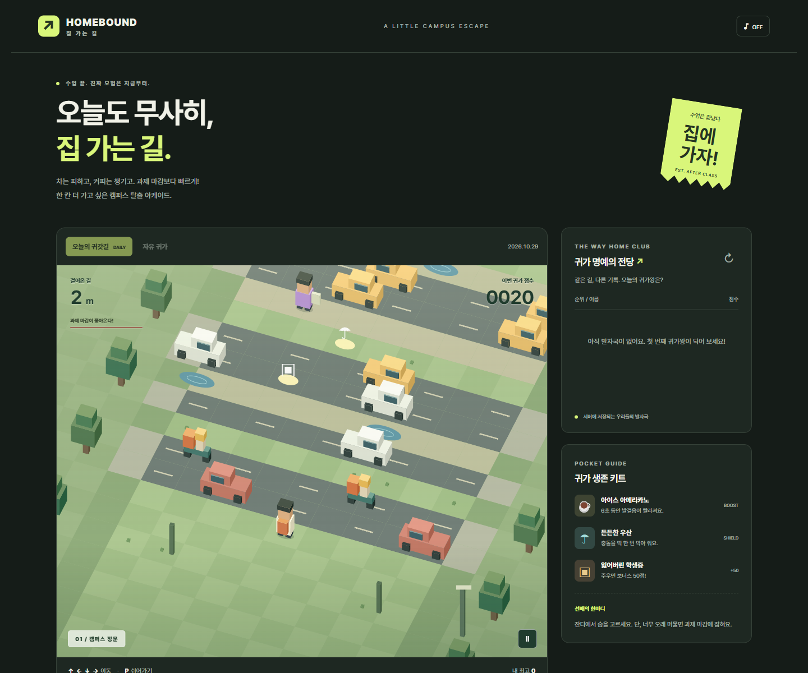
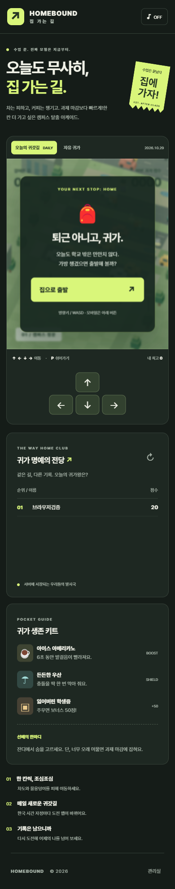

# 집 가는 길 · HOMEBOUND

> 수업은 끝났다. 자동차와 물웅덩이를 피해, 과제 마감보다 먼저 집으로!

**지능형 IoT 플랫폼 · 나만의 컨테이너 만들기 / 202355513**

[게임 실행](https://homebound-skygang-dev.apps.rm1.0a51.p1.openshiftapps.com/)

## 1. 컨테이너 소개

대학생의 귀갓길을 소재로 한 브라우저 아케이드입니다. Crossy Road의 한 칸 이동·장애물 회피 방식에서 영감을 받았으며, 캐릭터·캠퍼스·차량은 Canvas 코드로 직접 그린 독자적인 그래픽입니다. 원작의 이미지·음악·로고를 사용하지 않습니다.

간단한 웹 게임에 서버 랭킹을 연결하면 **게임 규칙의 설정 분리, 관리자 인증, 영구 저장, 상태 점검**을 하나의 서비스 안에서 설명할 수 있어 이 주제를 선택했습니다. 서버는 공개 Python 컨테이너 이미지에서 실행하며, 이미지를 직접 빌드하지 않습니다.

### 주요 기능

- **한 칸 이동:** 방향키/WASD, 모바일 방향 버튼, 캔버스 스와이프·탭.
- **3개 구간:** 캠퍼스 정문 → 30m 대학가 → 65m 집 앞 공사 구간. 이동 거리에 따라 차량이 빨라집니다.
- **장애물:** 이동 차량, 빠른 배달 오토바이, 물웅덩이, 시간을 빼앗는 설문조사 보행자, 방향을 바꾸는 취객.
- **아이템:** 커피(6초 이동 대기시간 단축), 우산(충돌 1회 보호), 학생증(+50점).
- **마감 타이머:** 최고 이동 거리를 갱신하지 않으면 18초 뒤 종료됩니다. 뒤로 갔다가 돌아오는 것으로 시간을 무한 연장할 수 없습니다.
- **오늘의 귀갓길:** 한국 시간 날짜를 서버에서 계산하고 같은 날짜에는 동일한 시드를 제공합니다. 같은 설정·게임 버전에서 맵과 장애물 진행이 재현됩니다.
- **자유 귀가:** 매 게임 다른 시드. 오늘의 랭킹과 별도 집계합니다.
- **랭킹:** 닉네임별 최고 점수 상위 10명. 오늘의 모드는 해당 날짜만, 자유 모드는 전체 기간을 집계합니다.
- **관리실:** Secret의 관리자 비밀번호와 초기화 확인 체크로 전체 기록을 초기화합니다.
- **일시정지:** P/Escape, 일시정지 버튼, 다른 탭으로 이동하면 자동 정지. 효과음은 기본 꺼짐입니다.

점수 = `최고 이동 거리 × 10 + 획득 학생증 수 × 50`.



## 2. 아키텍처



| 리소스 / 설정 | 이름 | 역할과 선택 이유 |
|---|---|---|
| Deployment | `homebound` | 게임 서버 Pod 1개를 관리하고 Pod 삭제 시 재생성 |
| Service | `homebound` | `app=homebound`인 Pod의 이름 있는 `http` 포트로 연결 |
| Route | `homebound` | 외부 HTTPS 접속, HTTP는 HTTPS로 전환. host는 배포 환경이 생성 |
| ConfigMap | `homebound-app` | Python·HTML·CSS·JS를 포함하여 YAML만으로 배포 가능 |
| ConfigMap | `homebound-config` | 제목·마감 시간·교통 속도·포트를 코드와 분리 |
| Secret | `homebound-secret` | 관리자 비밀번호를 일반 설정과 분리하고 서버에서 검증 |
| PVC | `homebound-data` | `/data/homebound.db`에 게임 세션과 랭킹 저장 |
| Startup Probe | `/health/ready` | 초기 DB 준비까지 최대 약 60초 허용 |
| Readiness Probe | `/health/ready` | 실제 DB 테이블 조회가 가능해야 트래픽 수신 |
| Liveness Probe | `/health/live` | HTTP 프로세스 생존 확인. 일시적인 DB 문제로 재시작하지 않음 |
| requests / limits | CPU 50m / 500m, 메모리 64Mi / 256Mi | Sandbox 자원 사용량을 명시적으로 제한 |

Probe는 독립적인 Kubernetes Object가 아니라 컨테이너 사양에 포함되는 설정입니다.

SQLite와 ReadWriteOnce 볼륨을 사용하므로 **replicas=1, 업데이트 전략 Recreate**를 선택했습니다. 여러 Pod가 동시에 같은 DB에 쓰도록 확장하는 구성은 아닙니다. 비루트 임의 UID는 OpenShift에 맡기고 고정 UID·namespace·storageClassName을 지정하지 않습니다. 루트 파일시스템은 읽기 전용이며, 쓰기 경로는 PVC(`/data`)와 임시 볼륨(`/tmp`)으로 한정합니다.

## 3. 사용 이미지

```text
registry.access.redhat.com/ubi9/python-312:latest
```

- Red Hat UBI9 Python 3.12 공개 이미지, 컨테이너 포트 **8080**.
- 기존 과제 환경의 비루트 실행에 적합하며 실제 Sandbox 실행으로 검증합니다.
- Python 표준 라이브러리 `http.server`, `sqlite3`, `json` 등을 사용합니다.
- 배포 시 pip/npm 설치, 프런트엔드 빌드, 외부 API 키, 별도 이미지 빌드가 필요 없습니다.
- `latest`는 변경 가능한 태그입니다. 실제 검증한 이미지 digest는 [배포 검증 기록](evidence/deployment-verification.json)의 `running_image`에 남깁니다.

## 4. 배포 방법

### 채점자용: 저장소의 YAML만으로 배포

OpenShift CLI에 로그인하고 본인 프로젝트를 선택한 후 **이 학번 폴더**에서 실행합니다.

```sh
oc project <본인-project>
oc apply -f k8s/
oc rollout status deployment/homebound --timeout=120s
oc get deployment,pod,service,route,pvc -l app=homebound
oc get route homebound -o jsonpath='{.spec.host}'
```

마지막에 출력되는 host에 `https://`를 붙여 접속합니다. `집으로 출발` 버튼과 게임 화면이 나타나야 합니다. 서버 상태는 `/health/live`, `/health/ready`에서 확인할 수 있습니다.

`k8s/`에는 **7개 리소스의 완성된 명세**가 들어 있습니다. `app/` 소스나 생성 스크립트 없이 `k8s/` 폴더만 복사해도 배포됩니다. JSON은 YAML 1.2의 부분집합이므로 생성된 `.yaml` 파일의 JSON 표기를 `oc apply -f k8s/`가 직접 읽습니다. 이 방식은 게임 소스의 줄바꿈·따옴표를 안전하게 포함하기 위해 사용했습니다.

### 설정 변경

`k8s/configmap.yaml`의 `data`에서 다음 값을 바꿀 수 있습니다.

| 설정 | 기본값 | 적용 범위 |
|---|---|---|
| `GAME_TITLE` | 집 가는 길 | 브라우저 페이지 제목 |
| `DEADLINE_SECONDS` | 18 | 전진하지 않을 때 종료까지의 시간, 10~60초 |
| `TRAFFIC_SPEED` | 1 | 교통 속도 배율, 0.5~2 |

```sh
oc apply -f k8s/configmap.yaml
oc rollout restart deployment/homebound
oc rollout status deployment/homebound
```

환경변수는 Pod 시작 시 읽으므로 재시작 후 새 게임부터 적용됩니다. 게임 도중의 설정은 그 게임이 시작할 때 받은 값으로 유지됩니다.

### 관리자 기능

하단 **관리실** → 비밀번호 입력 → 전체 기록 초기화 확인 → 초기화.

과제 재현용 공개 비밀번호는 `homebound-demo-2026!`입니다. 이는 의도적으로 공개한 **데모용 자격 증명**이며 실제 비밀이 아닙니다. 공개 운영 시 `homebound-secret`의 `ADMIN_PASSWORD`를 별도의 값으로 변경하고 Deployment를 재시작해야 합니다. Secret을 사용한다고 Git에 기록한 값이 비밀이 되는 것은 아닙니다. 비밀번호는 브라우저 번들에 포함하지 않으며 API에서 상수 시간 비교를 수행합니다.

### 소스 수정 / 로컬 실행

Python 3.12 이상에서 별도 의존성 설치 없이:

```sh
python app/server.py
```

`http://localhost:8080` 접속. 기본 데이터 경로는 `.local-data/`이며 Git에 포함하지 않습니다. 로컬 관리 기능은 `ADMIN_PASSWORD` 환경변수를 설정한 경우에만 활성화됩니다.

소스를 변경했으면 제출용 ConfigMap을 다시 생성합니다.

```sh
python scripts/build_manifests.py
oc apply -f k8s/
oc rollout restart deployment/homebound
```

생성기는 7개 명세를 모두 재생성하므로 설정 기본값을 영구 변경하려면 `scripts/build_manifests.py`도 수정합니다. `app-configmap.yaml`은 직접 편집하지 않습니다.

## 5. 배포 결과와 재현성 증빙

- 실제 리소스 상태와 실행 명령: [openshift-status.txt](evidence/openshift-status.txt)
- HTTPS 응답·Pod UID 변경·재생성 전후 랭킹·이미지 digest: [deployment-verification.json](evidence/deployment-verification.json)
- 실제 OpenShift HTTPS 주소의 Chrome 조작 검증: [live-browser.json](evidence/live-browser.json)
- 브라우저 캡처: 아래 화면은 로컬 Chrome에서 실제 조작하며 촬영한 화면입니다. 클러스터 배포 여부는 위 실제 `oc` 기록으로 구분하여 확인합니다.

아래 화면은 실제 **OpenShift Route**에 접속하여 촬영했습니다.


아래는 로컬 브라우저 테스트의 진행·결과·모바일 화면입니다.





### 검증 시나리오 A: YAML만으로 깨끗한 재배포

```sh
oc delete -f k8s/
oc apply -f k8s/
oc rollout status deployment/homebound --timeout=120s
```

이 절차는 **PVC도 삭제**하므로 기존 게임 기록을 보존하는 절차가 아닙니다. 과제의 새 환경 재현성을 검증하기 위해 수행합니다. 새 PVC에서 DB 테이블이 자동 생성되고 게임이 실행되어야 합니다.

### 검증 시나리오 B: Pod 재생성 후 데이터 유지

1. 자유 귀가에서 기록 저장.
2. `/api/leaderboard?mode=endless` 응답 저장.
3. `oc delete pod -l app=homebound` 실행.
4. Deployment가 새 UID의 Pod를 생성하고 Ready 상태가 될 때까지 대기.
5. 동일 랭킹 API 응답을 비교하여 기록 유지 확인.

PVC는 삭제하지 않습니다. 브라우저의 ‘내 최고’는 localStorage에 있는 별도 편의 기능이므로 영속성 증거로 사용하지 않고 **서버 랭킹 API 응답**을 비교합니다. `배포검증`이라는 20점 기록은 이 검증 과정에서 만든 테스트 데이터입니다.

두 절차를 자동 실행하고 증빙을 저장하는 명령:

```sh
python scripts/verify_deployment.py --recreate
```

**주의:** `--recreate`는 homebound의 PVC와 기록을 삭제합니다. 보존할 기록이 있다면 생략합니다. 다른 이름의 서비스나 기존 Lunch Vote PVC는 삭제하지 않습니다.

## 6. 테스트

```sh
python -m unittest discover -s tests -p test_server.py -v
python scripts/check_manifests.py
npm ci
npm test
npx playwright test
```

- Python 통합 테스트 5개: 상태 확인·정적 파일·경로 제한, 동일 날짜 시드, 점수 입력 검증·재제출 방지, 관리자 인증, **실제 서버 프로세스 재시작 후 데이터 유지**.
- Node 게임 규칙 테스트 4개: 시드 재현성, 안전 지대, 움직이는 장애물 충돌·통과 간격, 학생증 생성 상한·점수 계산.
- Chrome 브라우저 테스트 2개: 실제 키보드 이동·일시정지·마감·저장·재도전·모드 변경, 모바일 버튼·가로 넘침·관리자 오답/정답 처리.
- 브라우저 테스트는 설치된 Chrome을 사용합니다. `@playwright/test`는 개발 검증에만 필요하며 배포 컨테이너에는 포함하지 않습니다.

## 7. 어려웠던 점과 해결 과정

1. **YAML만으로 게임과 서버를 전달해야 하는 조건:** 원본을 `app/`에서 관리하고 생성기로 전체 런타임을 ConfigMap에 넣었습니다. 명세와 원본이 달라지지 않도록 재생성합니다.
2. **OpenShift 임의 UID와 저장 위치:** 고정 UID를 없애고 PVC에 DB를 저장합니다. 비루트 상태에서 실제 배포·쓰기·재생성을 검증했습니다.
3. **RWO 볼륨과 업데이트 시 동시 Pod:** SQLite 단일 Pod 구성에 맞춰 Recreate 전략을 선택했습니다.
4. **게임 재시작과 중복 점수 등록:** 서버 발급 일회용 토큰을 DB에 저장하고 트랜잭션 안에서 등록과 사용 처리를 수행합니다.
5. **모바일 자동 테스트의 시작 시점:** 시작 버튼 직후 서버 응답 전 이동하는 테스트가 실패했습니다. 시작 화면이 사라진 뒤 터치하도록 수정하여 실제 준비 상태를 기다립니다.
6. **캐릭터 그래픽:** 3D처럼 보이는 블록의 높이와 바닥 기준 높이를 분리하여 머리·몸·가방이 서로 가리지 않도록 수정했습니다.

### 범위와 한계

- 점수는 서버에서 계산하고 토큰 재사용·명백히 불가능한 거리·잘못된 닉네임을 거절하지만, 이동 전체를 서버에서 재실행하지 않으므로 **완전한 부정행위 방지 시스템은 아닙니다**.
- 닉네임은 계정 인증 수단이 아니며 동일 이름은 최고 기록으로 합쳐집니다.
- 서버의 게임 세션은 24시간 뒤 만료됩니다. 전날 시작한 일일 게임의 기록은 시작한 날짜에 속합니다.
- Python 표준 HTTP 서버와 SQLite의 소규모 과제용 구성입니다. 대규모 동시 접속·무중단 다중 인스턴스 운영을 목표로 하지 않습니다.

## 8. 채점 항목 대응

| PDF 평가 항목 | 배점 | 제출물에서 확인할 내용 |
|---|---:|---|
| 배포 성공 | 40 | `k8s/`만으로 재배포, Running/Ready, 실제 HTTPS 응답 |
| 소개·아키텍처 문서 | 25 | 서비스 목적, 구성도, 이미지·포트, 실행 캡처, 배포 증빙 |
| YAML 품질 | 20 | selector/label/port 일치, requests/limits, 고정 namespace/host·자동생성 필드 없음 |
| 추가 Object 활용 | 15 | ConfigMap·Secret·PVC 및 세 종류 Probe의 실제 역할과 검증 |

추가 Object 15점은 총점 100점에 포함됩니다. 평가자의 최종 점수를 보장하는 표는 아닙니다.

## 9. AI·참고자료 활용 내역

- **OpenAI Codex:** 서비스 기획 구체화, Canvas 게임·Python API 작성, YAML 생성기 작성, 테스트 자동화, 오류 수정, 문서 구성에 활용했습니다.
- AI 생성 코드와 YAML은 로컬 자동 테스트와 본인 OpenShift Developer Sandbox의 배포·재배포·PVC 영속성 검증을 거쳐 사용했습니다. 실제 결과는 `evidence/`에 기록합니다.
- 제공된 「[부산대학교](제5강 과제안내) 나만의 컨테이너 만들기」 PDF: 제출 구조, 100점 채점표, Sandbox 조건, 재배포 검증 기준.
- [Kubernetes Probe 공식 문서](https://kubernetes.io/docs/concepts/workloads/pods/probes/): 시작·준비·생존 점검 역할 구분.
- [Kubernetes ConfigMap](https://kubernetes.io/docs/concepts/configuration/configmap/), [Secret](https://kubernetes.io/docs/concepts/configuration/secret/), [Persistent Volume](https://kubernetes.io/docs/concepts/storage/persistent-volumes/): 설정·자격 증명·영속 저장 구성 참고.

## 10. 제출 전 확인

- [x] 작업물은 `students/202355513/` 안에 구성.
- [x] README 소개·아키텍처·이미지·배포·증빙·AI 활용 내역 포함.
- [x] `k8s/`에 자체 완결적인 배포 파일 포함.
- [x] YAML에 고정 namespace, Route host, uid, status 등 자동생성 필드 없음.
- [x] 전체 삭제 후 YAML만으로 재배포 성공, HTTPS 응답 확인.
- [x] 새 UID의 Pod 재생성 후 서버 랭킹 유지 확인.
- [ ] 최종 변경 사항을 본인 Git 저장소에 Commit·Push.
- [ ] 저장소 URL을 8주차 과제로 제출.

PDF 제출 기한: **2026-10-30 10:00**. 최종 제출 전 `evidence/`의 실제 검증 결과와 접속 상태를 확인하세요.
